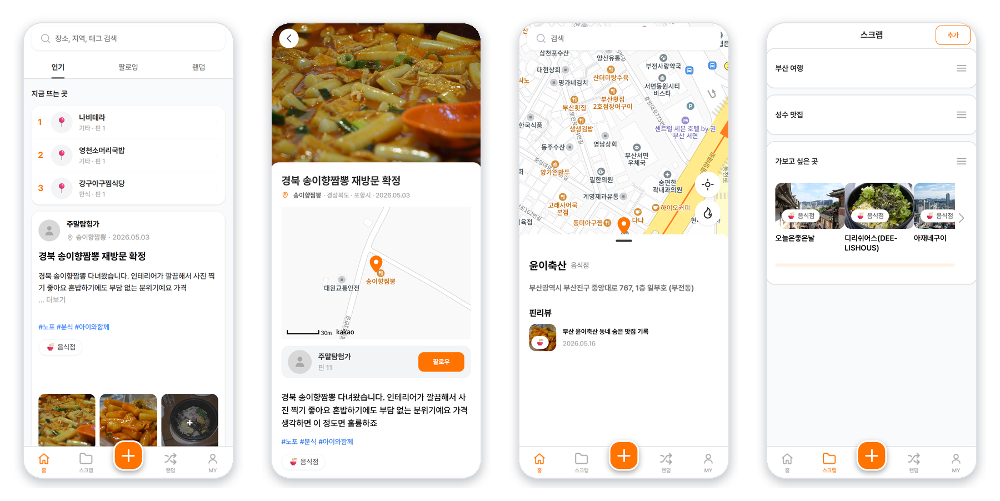

## 📍 핀플 (Pinple)

**핀으로 채우는 여행** — 다녀온 곳을 핀으로 남겨 나만의 지도를 만들고, 다른 여행자의 진짜 후기를 지도 위에서 찾아보는 여행 앱입니다. 
관광데이터 공모전 출품작 (2026.06 ~ 2026.09)

  

- **피드형 · 블로그형 핀** — 사진 위주로 가볍게, 또는 제목과 긴 글로 정리해서 기록
- **지도 위 장소핀** — 전국 장소 데이터(약 53만 곳)에 핀을 연결해 한곳에 모아 보기
- **검색 · 랜덤** — 지역 · 태그 · 카테고리로 찾고, 오늘 뜨는 곳과 랜덤 추천으로 발견
- **스크랩** — 가 보고 싶은 곳을 카테고리로 묶어 다음 여행 준비

 

## 🛠 Tech Stack

**App** 

**Server** 

**External** 

 

## 📂 Repositories

| 저장소 | 내용 |
| :--- | :--- |
| [Pinple_FE](https://github.com/Footprint-Lab/Pinple_FE) | React Native(Expo) Android 앱 |
| [Pinple_BE](https://github.com/Footprint-Lab/Pinple_BE) | Spring Boot API 서버 |
| [Pinple](https://github.com/Footprint-Lab/Pinple) | 협업 규칙 · API 문서 |

> 저장소는 비공개로 운영하고 있습니다.

 

## 👥 Members

| 이름 | 역할 | GitHub |
| :-: | :-: | :-: |
| 박지원 | Frontend | [@jaann20914-eng](https://github.com/jaann20914-eng) |
| 강민경 | Frontend | [@mingyeong0210](https://github.com/mingyeong0210) |
| 박준우 | Backend | — |
| 이가은 | Backend | [@Lee-gaeun](https://github.com/Lee-gaeun) |
| summmerc | Backend | [@summmerc](https://github.com/summmerc) |

화면 캡처의 장소 · 음식 사진은 위키미디어 커먼즈 자유 이용 사진입니다 — [사진 출처](images/PHOTO_CREDITS.md)

